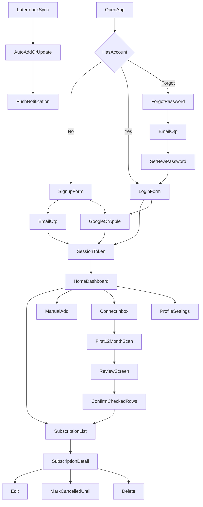

# Renewless product flow (locked)

This is the locked product journey for the Renewless API. Phases are not chosen yet. Do not treat later product as current backend work.

Source decisions: login-first auth, plus the six defaults at the bottom of this file. Guest onboarding and “account on first save” are dropped.

## Product

People keep every paid subscription in one place: Netflix, Apple, Google, Claude, Cursor, Codex, and anything else. The app shows what is active, what renews soon, what already expired, and what it costs this month.

The app reminds. The user cancels on the service itself. The app keeps a cancelled-until date when access still runs.

## Approved visual direction

Locked 24 October 2026: dark cool graphite `#151719`, neutral cards `#202326`, soft-white text `#E8EAED`, secondary gray `#9DA4AB`, soft mint-lime `#B9E58C`. Raleway Regular/Medium with old-style numerals. The [theme specification](theme.md) owns all visual tokens; [brand assets](brand/README.md) include the 51 × 51 mark. App icons will be prepared by the user. This approval changes visual direction, not feature scope or integration order. [Motion and Loop](motion-and-mascot.md) additionally lock the card-to-Detail transition, supported-iPhone Liquid Glass navigation, and limited companion placements; these do not change API behavior.

## Surfaces

Four pieces, one API:

- Phone app
- User website
- Admin website
- Backend API: Node.js and MongoDB, maintained separately

This repository is the React Native mobile client. Backend paths and API coverage below describe the separate API project; they are not mobile source paths.

## Locked account rules

- The user must sign up or log in before any product screen. The empty list is after auth, not before.
- Gmail connect is not sign-in. It attaches an inbox to an existing email account.
- OTP is required on email signup and password reset. Email login returns a session. No OTP on login.
- Google and Apple sit on both the signup and login screens. Firebase verifies the provider. If no Renewless account exists, the API creates one and returns a session. If one exists, the API logs them in. No OTP on social.
- Gmail connect is not Google login. Google login only creates or opens the Renewless account. Connecting an inbox is a later product step.
- The session stays on the server. Subscriptions and inbox tokens live on the server. The phone does not keep a separate local-only copy.

## 1. Auth

Locked plan, not live API yet. Do not change Postman or code until this auth slice is scheduled.

Current email routes: `src/routes/auth.ts`. Google and Apple are not in the API yet.

Signup and login screens both show: email form, Continue with Google, Continue with Apple.

### Email signup

1. User submits name, email, and password. Phone, date of birth, and gender are optional.
2. API creates the user, emails a 5-minute OTP, and does not return a session yet. The user can resend after 2 minutes.
3. User verifies OTP.
4. API returns `{ token, user }`. User lands on Home.

### Email login

1. Email and password.
2. Wrong credentials return a generic error. Right credentials return `{ token, user }`. Same Home.
3. If the account is still waiting on the signup OTP, login emails that signup code again and does not open a session.

### Forgot password

Email accounts only.

1. Email sends a 5-minute reset OTP. The user can resend after 2 minutes.
2. Verify OTP returns a short-lived reset token, not a session.
3. User sets a new password, then logs in again.

### Google and Apple

Same button on signup and on login. Same API result.

1. Phone signs in with Firebase (Google or Apple).
2. Phone sends the Firebase ID token to our API.
3. API verifies the token with the Firebase Admin SDK.
4. No Renewless user for that email or Firebase uid → create the account from the provider name and email. Phone, date of birth, and gender stay empty until profile edit. No password. No OTP.
5. User already exists → log them in. Attach the Google or Apple uid if it is missing.
6. API returns the same `{ token, user }` as email login. User lands on Home. Do not open a profile-complete screen first. If phone, date of birth, or gender is empty, Profile may show a small skippable banner.

If the same email already has a password account, Google or Apple opens that same account. One person, one row.

Apple Hide My Email is fine. First successful sign-in stores the relay email and the Firebase uid. Later sign-ins match on the Firebase uid.

Change password and forgot password stay off for an account that has no password.

### After session

Profile is read-only: name, email, phone, date of birth, gender, paid-so-far (estimated by currency from start date × cycle), and the linked Gmail list. Edit profile and change password are separate screens. Change password is hidden if the account has no password. Logout clears the server token and the stored FCM token.

### FCM token

One token per account.

1. Login, signup verify, and Google/Apple session send the current device FCM token. The API stores it on the user.
2. Home compares the device token with the stored token. Same → nothing. Different → update.
3. Logout clears the stored token.

A second phone overwrites the first. That is fine for v1.

### Firebase items needed before implementation

The backend only verifies the Firebase ID token and issues our session. The phone talks to Firebase first.

**From the Firebase project (required for backend)**

- Firebase project that we can use for Renewless
- Authentication enabled
- Google provider enabled
- Apple provider enabled
- A Firebase Admin service account JSON, or these three values:
  - `project_id`
  - `client_email`
  - `private_key`

Put those in the server environment later. Do not commit the JSON.

**From Firebase / Google Cloud (required for the phone app)**

- `google-services.json` for Android
- `GoogleService-Info.plist` for iOS
- Web client ID (OAuth 2.0 client that Firebase creates for Google)
- Android SHA-1 and SHA-256 fingerprints added on the Firebase Android app (debug and later release)

**From Apple Developer (required for Sign in with Apple)**

- Paid Apple Developer account
- App ID with the Sign in with Apple capability
- Services ID (used by Firebase and by Android / web Apple sign-in)
- Sign in with Apple key (`.p8`), plus Team ID and Key ID
- Those four pasted into Firebase → Authentication → Apple

We do not need user passwords from Google or Apple. We do not need Gmail API scopes for this login. Gmail inbox connect is a different OAuth later.

## 2. Home after login

Home is the first product screen. Top count cards, one recommendation check-in, then the upcoming list.

Current route: `GET /dashboard`.

- `active` — not expired
- `renewingSoon` — renewal in the next 7 days
- `thisMonth` — totals by currency for renewals in the current month
- `expired` — renewal date in the past
- `upcoming` — the soonest rows for the home strip

Recommendation: we cannot detect real usage of a third-party app. The card rotates on each app open between soonest upcoming and most expensive upcoming. Each kind has its own sentence and buttons (time: Keep it / I’ll cancel on the service / Already cancelled; money: Worth it / Too expensive / Already cancelled). The surface is one dark card with a narrow mint-lime edge. Same row can still switch kind so the sentence changes. Hide the card when nothing is upcoming. If live subscriptions exist and nothing is upcoming, a relaxed Loop may sit only in that empty area. The phone picks the card from the upcoming list.

Empty state after first login: no subscriptions yet. A still, friendly Loop sits with **Add manually** and **Connect inbox**. The buttons stay the action. The first successful save may play one Loop nod or blink. Later saves do not. See [motion-and-mascot.md](motion-and-mascot.md).

## 3. Manual subscriptions

One form (locked): name (catalog search or new), category (select, no subcategory), price, currency, cycle (`weekly` / `monthly` / `yearly`), optional start date, next renewal (typed or estimated from start + cycle), optional note. Reminder defaults follow the cycle. No custom cycle. New apps join the shared catalog on save.

Status is computed, not stored:

- `expired` if `nextRenewal` is before today
- `upcoming` if renewal is today through the next 7 days
- `in_progress` otherwise

### List filters

Locked. Search by name. Status chips: All (default), Upcoming (next 7 days), In progress. Expired and Cancelled are **History only**, not on List. **No renewal** is a banner when 1+ live rows have no next date (“2 have no renewal”), hidden at 0. Category filter. Sort by next date only, not price.

### History

Locked. From Profile. Expired and cancelled rows only. Search, status (All / Expired / Cancelled), category, ended-on date range.

### Payments

Locked. From Profile. Paid so far and this month as one chip per currency. No conversion. Charge list by date (estimated from start + cycle until real charges exist). Search, category, charge-date range. Skip No renewal. Cancelled counts through access-until.

### Detail

Locked. Edit uses the same form. “I cancelled this” sets access-until (default next renewal if unknown). Disclaimer: this only records it in Renewless; it does not cancel the real service. Delete is secondary and says the same. No deep link to cancel on Netflix or Apple.

### Stored fields

Each subscription stores: name, amount, currency, cycle, start date, next renewal, renewal source, last charge, category, notes, reminder on or off, source (`manual`, `gmail`, `icloud`, `voice`, `prompt`), and source email when it came from an inbox.

Renewal source:

- `confirmed` — written in a receipt, renewal, or cancellation email
- `predicted` — last charge plus cycle; the row shows Estimated
- `user` — typed or corrected by the user; shown the same way as confirmed

Editing an estimated date switches it to `user`.

### How a row gets in

1. Manual form
2. AI chat — text, voice, or image. Summary in the chat; user fixes in chat; Create from the chat. Image (e.g. Settings subscriptions) goes to Gemini vision and is not stored.
3. Voice — same chat, voice bubble only, hidden transcript, same summary + create
4. Gmail inbox
5. iCloud mail, after Gmail
6. Settings screenshot — attach in Paid AI chat; Gemini vision; image not stored after extract

## 4. App catalog (locked)

A shared list of known apps. Not a user tab. Name + category only. Names come from the starter list, from a user/Gmail/AI new real product, or from **admin add** (admin can also edit/merge later). Raw bank strings stay off the catalog. `PAYPAL *NETFLIX` becomes Netflix.

## 5. Gmail

Connect is OAuth Gmail read, not typing an email into a form. The user already has an app account. Current `POST /connectors` is a stub and is not the locked product.

1. User connects one or more Google accounts. Each inbox is a connector on the same user.
2. First scan reads the last **12 months** only. Hits go to Review, not the list. Current finds start checked; older finds are collapsed and unchecked. Confirm once. Only checked rows become subscriptions. Reminders schedule after that confirm.
4. The connection stays. Later mail is incremental from Gmail `historyId`. Path is query, then rules, then AI (**Gemini Flash** on from, subject, date, trimmed body). Same extract as the Add form fields. Do not invent price or date. The model never sees the whole inbox.
5. One real subscription is one card. Mail for a row the user already added (manual / AI / voice) updates that row: last paid confirmed, price if changed, next date confirmed only when it was Estimated. Source stays manual/AI/voice. Unclear match (two Netflix) is skipped, not a new card. The same receipt on two inboxes updates once. Work vs personal can stay two cards when they were already two.
6. Cancellation mail sets cancelled-until on the matching card. The date in that mail is `confirmed`.
7. Disconnect drops that inbox’s imported items. Manual rows stay.
8. The refresh token is encrypted at rest. Full emails are not stored.

Later syncs do not open review again. They add or update and send a notification. The user can edit or delete.

### Gmail sync rules

1. First scan is the last 12 months. Mail older than that is not read.
2. The connection stays until the user disconnects. Disconnect stops sync and drops that inbox’s imported items.
3. Later scans start where the last one stopped (`historyId`, `lastSyncedAt`). If Gmail says the id is too old, fall back to `after:<lastSyncedAt>`.
4. Query, then rules, then AI. Already-seen message ids, newsletters, and mail with no amount and no renew or cancel language are dropped. AI receives from, subject, date, and a trimmed body.
5. Cancellation mail is in that same path. A match sets cancelled-until on the existing card.
6. Confirmed and user dates show as the date. Predicted dates show the date plus Estimated.
7. The refresh token is encrypted at rest with AES-256-GCM. The key is in the server environment, not in Mongo.

After the first scan, the 12 months are not read again. New mail is noticed with Gmail `users.watch` through Pub/Sub, and a 6-hour incremental fallback. If `historyId` has not changed, the run stops and does not call the model.

Each connected account stores the Gmail address, encrypted refresh token, `historyId`, `lastSyncedAt`, and `initialSyncCompletedAt`. A Gmail message id is stored once so a retry does not apply the same mail twice.

## 6. Reminders

Reminders are push notifications from the server, in the user’s local timezone. The phone’s notification token and timezone are saved on the account.

Times are rewritten when a subscription is added, edited, or updated from email, a cancellation comes in, reminders are switched, or the timezone changes. Unsent reminders for that subscription are removed first.

The queue is a Mongo collection, one row per future push, with `fireAt`, the subscription, and the message. A worker sends rows whose time has come. A time already in the past is not scheduled. The phone does not keep the schedule.

Defaults by cycle:

- Weekly — the morning it renews, at 09:00
- Monthly and custom — 3 days before, and the morning it renews, at 09:00
- Yearly — 7 days before, 1 day before, and the morning it renews, at 09:00

One push per subscription per day. A predicted date says Estimated. A cancelled-until subscription gets one push the day before access ends, worded as access ending. Nothing sends after the date has passed.

On each subscription the user can switch reminders off, or pick 1 day, 3 days, or 7 days, still plus the morning it renews. No profile-wide mute in v1.

Alerts (locked): only notifications already sent. Future fire times stay off this tab. Off reminders are never sent and never listed. Tap opens Detail. Empty copy is “No alerts yet”, with a calm still Loop. One tap may blink or nod. No Loop on the rows.

Current `GET /notifications` only lists subscription dates. It does not send push.

## 7. Later product

Same story, later build. Not current backend work.

- iCloud mail — app-specific password, IMAP, same extract and review or sync rules as Gmail
- Voice and text prompt — confirm card, then save
- Screenshot — via Paid AI chat (locked); not a separate flow
- This app’s own plan (RevenueCat) — last
- Admin — sign in, catalog, users, a few counts

The app never cancels a third-party subscription. Apple Settings list and Apple Card are out of scope.

### Plans (locked)

- **Free:** the full manual app, plus **one** Gmail **first scan** (12-month Review + Confirm), plus up to **25** live subscriptions.
- **Paid:** Gmail **incremental updates** after that first scan, AI chat, voice, extra Gmail inboxes, 26th+ row.
- Without Paid, the first import stays but does not refresh.
- Paid prices: monthly **$3.99** (1 week free), 3 months **$9.99** (1 week free), yearly **$29.99** (first month free).
- Billing: **RevenueCat** + App Store + Play. Not store-only custom code, and not RevenueCat instead of Apple/Google.
- Paywall UI last.

## Current API coverage

Already present:

- Auth with OTP, profile, password change, logout
- Manual subscription create, read, update, delete
- Dashboard counts and upcoming strip
- List filters by status
- Connector and review add or dismiss as a fake seed, not real Gmail

Not present, and not to be built until phases are chosen:

- Category, last charge, cancelled-until, reminder prefs, source, needs-date
- Real Gmail OAuth, 12-month scan, history sync, encrypted tokens, dedupe
- Batch review confirm
- Push reminder queue, worker, and device timezone
- App catalog and admin
- AI chat (text, voice and image), widgets, RevenueCat (locked but deferred)
- iCloud (later/out of v1, not part of the locked first release)

## Locked defaults

1. Upcoming window is 7 days.
2. OTP only on signup and password reset. Login returns a session.
3. UI language for v1 is English.
4. Free includes one Gmail. Paid is AI chat, voice, and extra Gmail inboxes.
5. Categories are in the first backend slice: free-text plus a starter list.
6. Cancelled-until is in the first backend slice.

Screen-by-screen integration lock: [product-screens.md](product-screens.md). Theme: [theme.md](theme.md). Motion and Loop: [motion-and-mascot.md](motion-and-mascot.md).

Exclusions and deferred integration: [not-in-v1.md](not-in-v1.md). Feature list: [feature-list.md](feature-list.md). Billing: [revenuecat.md](revenuecat.md).

Scope terminology and dependency boundaries: [implementation-scope.md](implementation-scope.md). Next step: choose detailed implementation milestones within those boundaries. No feature code until that milestone split exists.
